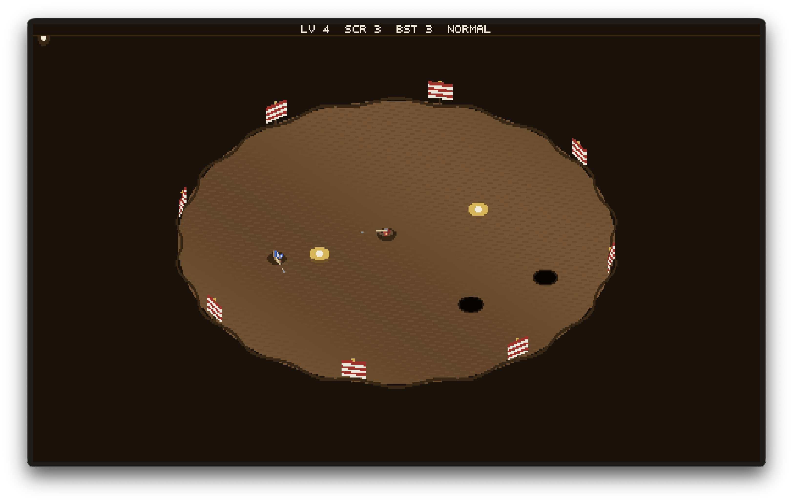

# knightty

A jousting game that runs in your terminal.



Two mounted knights, one narrow lane, one lance each. Aim your lance, time your jump, unhorse your opponent. Rendered entirely with halfblock pixels and a bitmap font — no graphics window, just your terminal.

## Run

```sh
cargo run --release
```

Built and tested with Rust 2021. Sound is on by default; the assets ship in `assets/sfx/`.

## Controls

| Key            | Action          |
|----------------|-----------------|
| `WASD` / arrows | Move the knight |
| `Space`        | Jump            |
| `R`            | Restart (after a round) |
| `Esc`          | Back to menu    |
| `Ctrl-C`       | Quit            |

Difficulty (EASY / NORMAL / HARD) is selectable from the main menu.

## Built with

- [ratatui](https://ratatui.rs) + [crossterm](https://github.com/crossterm-rs/crossterm) for terminal rendering
- [rodio](https://github.com/RustAudio/rodio) for sound
- A halfblock framebuffer with a custom bitmap font, so every glyph and sprite shares one coordinate system and scales together across terminal font sizes

## Tips

- Use a terminal font in the 4–12pt range for the best fit. The menu adapts at larger sizes but the game is most readable here. The lower the "better graphics".
- A truecolor terminal (most modern ones) is required for the palette.
